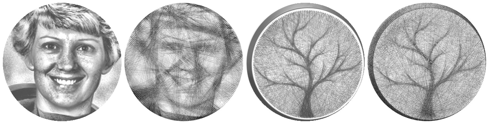

# stringart-claude

Du *string art* calculé : à partir d'une photo, trouver **dans quel ordre passer un fil autour de
clous** plantés sur le pourtour d'une toile ronde pour que la toile, vue de loin, ressemble à la
photo.



*De gauche à droite : un portrait tel qu'on le demande à la toile, la pièce simulée (240 clous,
2 557 cordes, 918 m de fil) ; la photo d'une vraie pièce de string art prise comme cible, et sa
reconstruction.*

Le projet a deux objectifs :

1. **Un outil qui sert.** Une image entre ; il en sort un aperçu fidèle de la pièce et la
   séquence de clous sous une forme qu'on peut suivre à la main pendant des heures.
2. **Un banc d'essai.** Choisir les cordes est un problème d'optimisation combinatoire. Sept
   méthodes de résolution sont comparées sur le même modèle et le même objectif.

Ce dépôt est le pendant « codé par Claude » de [`stringart`](https://github.com/ekitzing92/stringart),
écrit à la main sur le même sujet.

## Installation

Le projet utilise [uv](https://docs.astral.sh/uv/).

```bash
uv sync
```

## Calculer une pièce

```bash
uv run stringart-claude creer photo.jpg
```

écrit dans `sortie/` :

| fichier | usage |
|---|---|
| `sequence.txt` | la suite de clous, dix par ligne avec le rang des passages — à imprimer |
| `guide.html` | la même, pas à pas : un gros numéro, lecture à voix haute, avance automatique, reprise là où l'on s'est arrêté. À ouvrir sur un téléphone posé près de la toile, sans réseau |
| `piece.svg` | le tracé à l'échelle 1 avec la position des clous : imprimé sans mise à l'échelle, c'est le gabarit de perçage |
| `rendu.png` | la simulation de la pièce terminée |
| `comparaison.png` | la cible à côté de la simulation |

**Convention de numérotation : le clou 0 est en haut, les numéros croissent dans le sens des
aiguilles d'une montre.** Dans la séquence, deux numéros consécutifs signifient « longer le bord
jusqu'au clou voisin ».

Les réglages, dans l'ordre où il vaut la peine d'y toucher :

| option | effet |
|---|---|
| `--zoom 1.5 --decalage 0 -0.1` | cadrer : que le sujet remplisse le disque |
| `--relief 0.03` | force du contraste local : 0,03 pour un visage, 0,01 pour une photo chargée de textures (défaut 0,02) |
| `--contraste auto` | couper le contraste local (dessin, image déjà très contrastée) |
| `--noir 0.3` | valeur visée pour les noirs ; plus haut : pièce plus légère, moins de fil |
| `--diametre 500 --clous 240 --fil 0.2` | la vraie toile et le vrai fil, en millimètres |
| `--cordes-max 1800` | borner le nombre de cordes, donc le temps de montage |

```bash
uv run stringart-claude creer images/portrait.png --zoom 1.55 --relief 0.03 -o sortie
```

`uv run stringart-claude creer --help` les décrit tous. En Python :

```python
from stringart_claude import Toile, creer

oeuvre = creer("photo.jpg", Toile(diametre_mm=500, n_clous=240, epaisseur_fil_mm=0.2), relief=0.03)
print(oeuvre.resume())
oeuvre.enregistrer("sortie")
```

### Choisir une méthode

`--algo` choisit la méthode de résolution ; `uv run stringart-claude algos` les liste. Les notes
viennent du banc d'essai (moyenne sur quatre images, toile de 240 clous) :

| méthode | qualité | retard sur le meilleur objectif | temps | |
|---|---|---:|---:|---|
| `recherche_locale` | ★★★ | +0,5 % | ≈ 1 s | **recommandée** : pose ou retire la meilleure corde jusqu'à l'optimum local |
| `tabou` | ★★★ | +0,05 % | ≈ 2 s | recherche tabou partant de la précédente |
| `recuit` | ★★★ | +0,01 % | ≈ 5 s | recuit simulé partant de la recherche locale |
| `relaxation` | ★★★ | +0,3 % | ≈ 8 s | optimisation continue puis arrondi réparé ; sert aussi de borne |
| `glouton_global` | ★★☆ | +1,3 % | < 1 s | glouton sans retour en arrière |
| `glouton_sequentiel` | ★★☆ | +2,6 % | < 1 s | la méthode historique : le fil repart du dernier clou |
| `tri_naif` | ☆☆☆ | +535 % | < 1 s | témoin négatif |

Les six premières sont indiscernables à l'œil : **la méthode n'est pas ce qui limite le rendu.**
Ce qui compte est en amont (cadrage, mise en tons) et dans la physique (nombre de clous, finesse
du fil). C'est la principale conclusion du carnet.

Pour refaire le banc sur ses propres images :

```bash
uv run stringart-claude banc images/*.png
```

## Le carnet d'exploration

[`notebooks/exploration.ipynb`](notebooks/exploration.ipynb) retrace toute la démarche, images et
chiffres à l'appui : les essais, les échecs (sept sont racontés), les succès, et ce que chacun
apprend. Il se termine par une section pratique pour calculer sa propre pièce. C'est le meilleur
point d'entrée pour comprendre le projet.

Sa source est [`notebooks/exploration.py`](notebooks/exploration.py), un fichier à cellules `# %%`
qui se relit et se compare comme du code ; VS Code et Cursor l'ouvrent comme un carnet. Le
`.ipynb` en est la version exécutée. Après toute modification du `.py` :

```bash
uv run jupytext --to ipynb --execute notebooks/exploration.py   # ≈ 3 minutes
```

## Comment ça marche

**Le modèle du fil.** Un fil est opaque et bien plus fin qu'un pixel de calcul ; il cache une
fraction `c` de chaque pixel qu'il traverse. Deux fils qui se croisent se recouvrent en partie :
la part de toile encore visible est le *produit* des parts laissées par chacun. Ce produit est
une quantité de lumière ; ce que l'œil en perçoit — et ce à quoi une image se compare — en est la
racine 2,2-ième (gamma). Le modèle s'écrit donc, pour un pixel `p` et un ensemble `S` de cordes :

    T[p] = ∏ (1 − c[p, k]) ** (1 / 2.2)      pour k dans S

Ce modèle est validé contre une **simulation indépendante** de la pièce (chaque fil dessiné à sa
vraie largeur sur une image de 7 500 pixels de côté), qui sert aussi de juge au banc d'essai.

**L'objectif.** L'écart quadratique moyen entre `T` et l'image cible, sur le disque.

**Le moteur.** Poser ou retirer une corde ne change que les pixels qu'elle traverse. Le moteur
tient à jour, pour chacune des 26 520 cordes, la variation d'objectif que provoquerait sa
bascule : choisir le meilleur coup est une recherche de minimum, et un coup coûte 0,3 ms. Une
résolution complète tient en une seconde.

**Le fil continu.** L'image ne dépend pas de l'ordre de pose. Les solveurs choisissent donc
librement leurs cordes ; un parcours d'un seul tenant est reconstruit ensuite par un chemin
eulérien, en reliant par le bord les clous dont le nombre de cordes est impair.

## Organisation du dépôt

```
src/stringart_claude/
├── image.py        chargement, cadrage dans le disque, mise en tons de la cible
├── toile.py        géométrie : clous, cordes, matrice de couverture
├── moteur.py       modèle du fil, objectif, gains tenus à jour
├── solveurs.py     les sept méthodes et leur registre
├── sequence.py     du jeu de cordes au fil continu ; mise en forme de la séquence
├── rendu.py        simulation de la pièce, planches, SVG
├── evaluation.py   le juge : notes d'un rendu contre sa cible
├── banc.py         le banc d'essai
├── guide.py        le guide de montage HTML
├── atelier.py      la chaîne complète (`creer`, `Oeuvre`)
└── cli.py          la commande `stringart-claude`
notebooks/          le carnet d'exploration (.py source, .ipynb exécuté)
tests/              un fichier de test par module
images/             les images de travail
```

## Développement

```bash
uv run pytest                      # tests
uv run ruff check . && uv run ruff format .
uv run --with pyright pyright      # types (mode standard, zéro signalement)
```

## Feuille de route

À faire, par ordre de priorité :

- [ ] **Une interface, voire une application**, qui emballe tout cela de façon ergonomique et
      soignée : choisir l'image, la cadrer à la souris, régler les tons en voyant le résultat,
      choisir la méthode (avec l'indication de celles qui sont recommandées), exporter les
      livrables.
- [ ] **La résolution en temps réel** : voir le rendu se construire pendant le calcul, avec des
      instantanés aux différentes étapes. Le socle est en place — chaque solveur accepte un
      crochet `suivi(etat, n_coups)` appelé tous les cent coups, et rend un *journal* de toutes
      les cordes basculées qui permet de rejouer la résolution (`Resultat.cordes_a(n)`) ; le
      carnet s'en sert déjà pour ses planches d'étapes. Reste à le brancher sur un affichage.

Pistes repérées en chemin :

- Toiles non circulaires (le moteur ne suppose rien sur la forme ; la géométrie, si).
- Fil de couleur, ou plusieurs fils.
- Pondération par zones d'intérêt (`Probleme` accepte déjà une carte de poids).
- Prise en compte du diamètre des clous et du côté par lequel le fil les contourne.
- Réglage automatique du `relief` selon l'image, aujourd'hui laissé à l'œil.

## Limites connues

- Les sujets clairs à petits détails sombres restent difficiles : on ne peut assombrir un point
  qu'en traçant des droites qui traversent toute la toile.
- La bonne mise en tons dépend de l'image ; il n'y a pas de réglage universel.
- Les notes du juge suivent l'œil dans les grandes lignes seulement : entre deux rendus proches,
  c'est l'œil qui tranche.
- La géométrie complète occupe environ 140 Mo en mémoire à 240 clous, 220 Mo à 300.

## Images

`chat.jpg`, `chat_detoure.png`, `arbre.png` et `elephant.png` viennent du dépôt `stringart`.
`portrait.png` est un recadrage du portrait officiel de l'astronaute Eileen Collins (NASA,
domaine public), distribué avec scikit-image.
